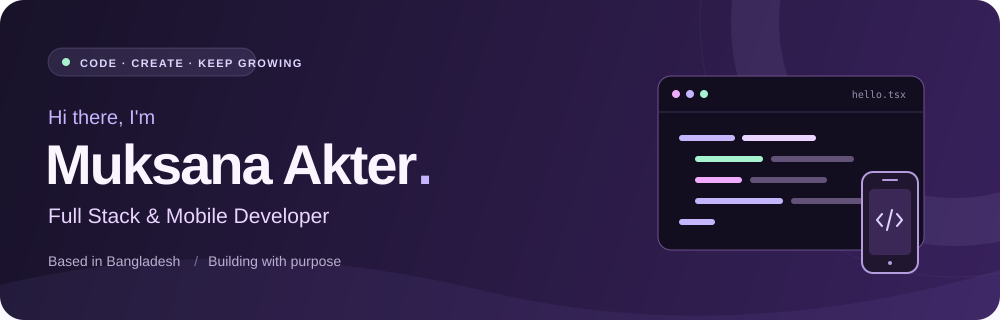
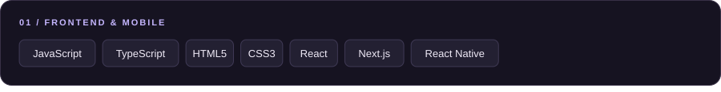
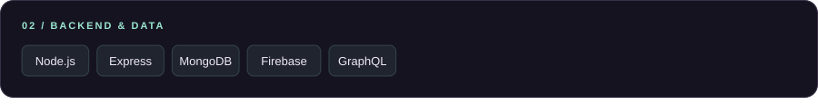
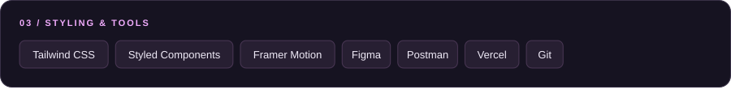

  

  <strong>Thoughtful interfaces. Smooth interactions. Useful software.</strong> 
  Building web &amp; mobile experiences with care, curiosity, and a little creativity.

  <a href="https://www.linkedin.com/in/muksana-akter-66a2b7292">LinkedIn</a> &nbsp;·&nbsp;
  <a href="https://github.com/MuksanaAkter?tab=repositories">My repositories</a> &nbsp;·&nbsp;
  <a href="https://www.linkedin.com/company/xiia">XIIA</a>

---

### A little about me

Hi! I'm **Muksana**, a **Full Stack & Mobile Developer** based in **Bangladesh**. I enjoy turning complex ideas into simple, intuitive experiences that feel good to use.

- **Currently:** Software Developer at **[XIIA](https://www.linkedin.com/company/xiia)**
- **Building with:** React, Next.js & React Native
- **I care about:** polished interfaces, thoughtful UX & smooth animations
- **Behind the UI:** Node.js, Express, Firebase & MongoDB
- **Always:** learning, experimenting & improving my craft

 

### From idea to experience

- **Design → interface** — Bringing Figma designs to life with attention to the details.
- **Web → mobile** — Building responsive websites and cross-platform React Native apps.
- **Interface → data** — Connecting experiences to REST APIs, GraphQL, and Firebase.
- **Details → delight** — Adding purposeful motion with Framer Motion and clean, reusable components.

### My toolkit

  
  
  

### Around GitHub

Explore what I'm building, the code I'm sharing, and my latest public activity.

**[Browse repositories ↗](https://github.com/MuksanaAkter?tab=repositories)** &nbsp;·&nbsp;
**[Contributions & activity ↗](https://github.com/MuksanaAkter#contributions)** &nbsp;·&nbsp;
**[Things I've starred ↗](https://github.com/MuksanaAkter?tab=stars)**

---

  <strong>Let's connect</strong> 
  Have an idea, a project, or a shared love for building things?  
  <a href="https://www.linkedin.com/in/muksana-akter-66a2b7292">Say hello on LinkedIn ↗</a>

  

